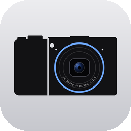
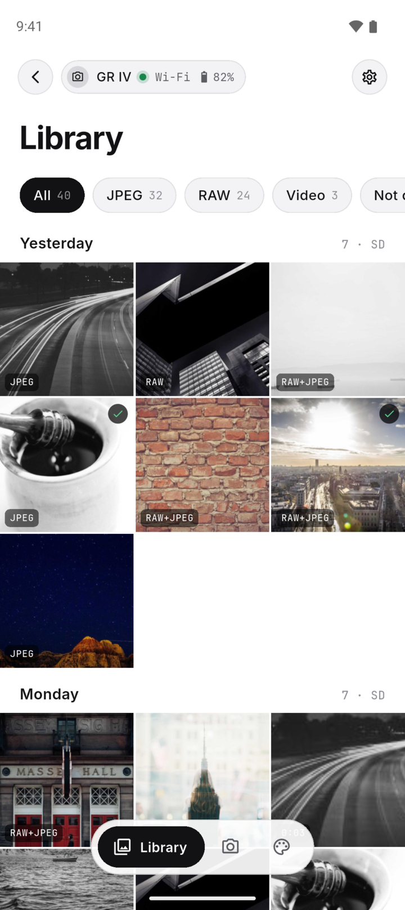
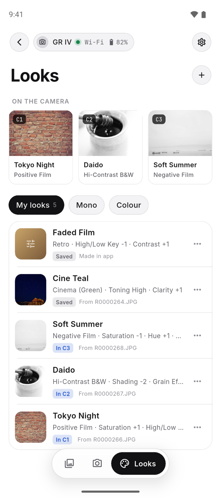
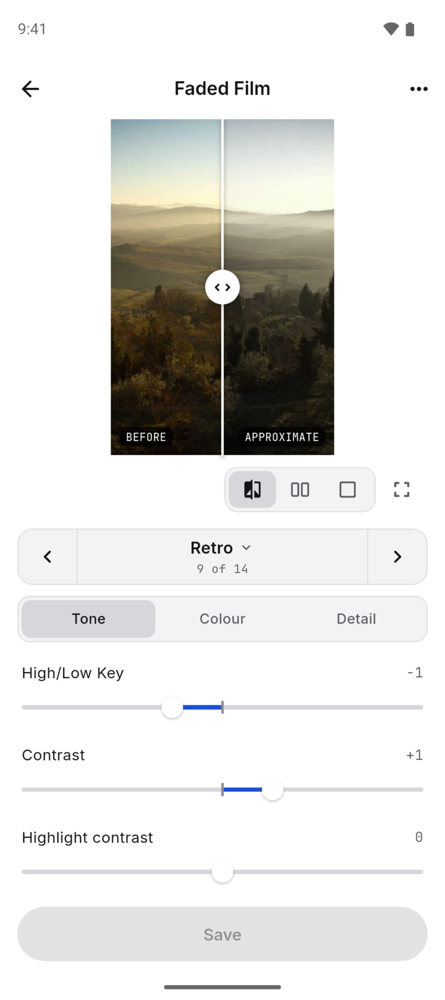
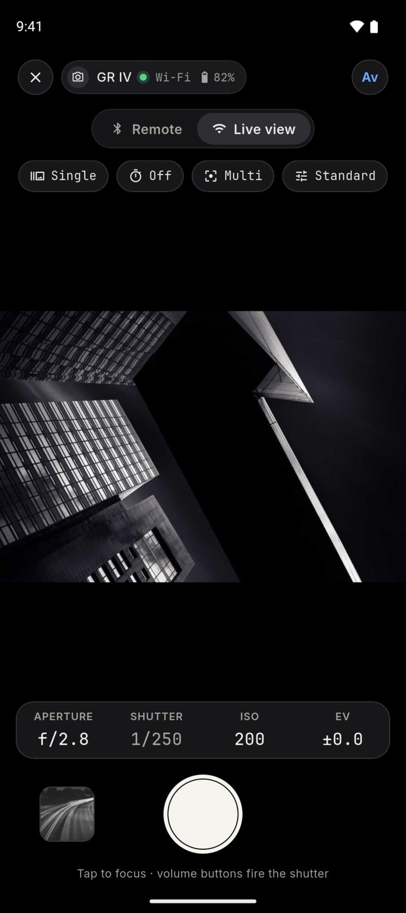

<p align="center">
  
</p>

<h1 align="center">GR Photo</h1>

<p align="center">
  <a href="../../LICENSE"></a>
  
</p>

<p align="center">
  <a href="../../README.md">English</a> ·
  <a href="README.fr.md">Français</a> ·
  <a href="README.de.md">Deutsch</a> ·
  <a href="README.es.md">Español</a> ·
  <a href="README.pt.md">Português</a> ·
  <a href="README.it.md">Italiano</a> ·
  <a href="README.nl.md">Nederlands</a> ·
  <a href="README.da.md">Dansk</a> ·
  <a href="README.sv.md">Svenska</a> ·
  <a href="README.fi.md">Suomi</a> ·
  <a href="README.pl.md">Polski</a> ·
  <a href="README.cs.md">Čeština</a> ·
  <a href="README.hu.md">Magyar</a> ·
  <a href="README.tr.md">Türkçe</a> ·
  <a href="README.el.md">Ελληνικά</a> ·
  <a href="README.ru.md">Русский</a> ·
  <a href="README.th.md">ไทย</a> ·
  <b>한국어</b> ·
  <a href="README.zh.md">中文简体</a> ·
  <a href="README.zh-Hant.md">中文繁體</a> ·
  <a href="README.ja.md">日本語</a>
</p>

**GR Photo**은 Ricoh GR 카메라(GR III, GR IIIx, GR IV)를 위한 iOS 및 Android용 컴패니언 앱입니다.
카메라에 있는 사진을 둘러보고 다운로드하고, 라이브 뷰가 있는 리모트 셔터로 쓰고, 화상 컨트롤 룩을
한곳에 모아 둘 수 있습니다. 빠르고 쓰기 쉽도록, 그리고 카메라의 컬러 프로파일을 제대로 관리할 수
있도록 만들었습니다. 사진을 촬영할 때 적용된 룩을 저장하고, 미리보기를 보면서 편집하고, 카메라의
커스텀 슬롯에 등록할 수 있습니다.

GR Photo는 독립 프로젝트이며 Ricoh와 제휴 관계가 없습니다. 카메라와는 Ricoh의 자체 앱과 카메라
펌웨어를 리버스 엔지니어링해 알아낸 프로토콜로 통신하며, 그 조사 결과는
[`research/`](../../research/README.md)에 정리되어 있습니다.

<p align="center">
  <picture>
    <source media="(prefers-color-scheme: dark)" srcset="../screenshots/library-dark.png">
    
  </picture>
  <picture>
    <source media="(prefers-color-scheme: dark)" srcset="../screenshots/looks-dark.png">
    
  </picture>
  <picture>
    <source media="(prefers-color-scheme: dark)" srcset="../screenshots/look-editor-dark.png">
    
  </picture>
  
</p>

<p align="center">
  <sub>라이브러리, 룩, 룩 편집기, 라이브 뷰. 시뮬레이션 카메라를 사용하는 데모 모드에서 촬영한 화면입니다.</sub>
</p>

## 목차

- [기능](#기능)
- [요구 사항](#요구-사항)
- [설치](#설치)
- [사용법](#사용법)
- [개발](#개발)
- [기여하기](#기여하기)
- [감사의 말](#감사의-말)
- [라이선스](#라이선스)

## 기능

GR Photo는 세 가지를 가장 중요하게 여깁니다. 사진을 빨리 볼 수 있을 것, 사용자를 번거롭게 하지 않을
것, 그리고 화상 컨트롤 룩을 관리할 가치가 있는 것으로 다룰 것입니다.

- **빠릅니다.** 카메라가 근처에 있으면 GR Photo는 앱이 열릴 때 Bluetooth로 카메라에 연결합니다.
  라이브러리를 열면 카메라를 깨우고 카메라의 Wi-Fi를 켜서 연결하는 과정이 한 번에 이루어지며, 그
  뒤로는 페이지를 오가는 동안 Wi-Fi가 유지되므로 다시 연결하는 일이 없고 다운로드도 계속
  진행됩니다. 파일 목록, 썸네일, 미리보기는 휴대전화에 캐시되어 라이브러리가 빨리 열립니다.
  GR IV HDF와 Android 휴대전화를 사용했을 때, 전원이 꺼져 있던 카메라에서 라이브러리가 열리기까지
  약 13초가 걸렸습니다.
- **쓰기 쉽습니다.** 한 화면에 카메라가 모여 있고, 거기서 한 번만 탭하면 라이브러리, 촬영, 룩으로
  이동합니다. GR Photo가 카메라의 전원을 켜고 Wi-Fi를 켜서 연결까지 해 주므로 페어링한 뒤에는
  카메라에서 설정할 것이 없습니다. 문제가 생기면 원인과 확인할 사항을 알려 주고 ‘다시 시도’를
  표시합니다. 끊어진 연결은 저절로 복구됩니다.
- **관리할 수 있는 룩.** 라이브러리의 모든 사진에는 촬영할 때 적용된 화상 컨트롤이 표시되며, 한
  번만 탭하면 룩으로 저장됩니다. 룩은 어느 카메라에서 가져왔든 휴대전화에 보관되며, 설정값과
  원본이 된 사진, 그리고 그 룩이 등록된 커스텀 슬롯을 나타내는 태그가 함께 저장됩니다.
- **미리보기가 있는 룩 편집기.** 베이스가 되는 화상 컨트롤과 거기에 딸린 모든 파라미터를 바꿀 수
  있습니다. 파라미터는 톤, 컬러, 디테일, 효과로 묶여 있으며, 결과는 내 사진이나 샘플 사진으로
  확인합니다. 적용 전과 후 사이의 구분선을 밀어서 비교하거나, 둘을 나란히 놓거나, 탭해서 번갈아
  볼 수 있습니다. 미리보기는 펌웨어를 분석해 알아낸 카메라의 렌더링을 근사한 것입니다
  ([`research/image-control-processing.md`](../../research/image-control-processing.md)).
- **카메라에 룩 등록.** 룩 페이지에는 카메라의 커스텀 슬롯 C1~C3에 들어 있는 내용이 표시됩니다.
  저장한 룩을 슬롯으로 드래그하거나 룩의 메뉴에서 ‘등록’을 선택하면 카메라에 들어갑니다. 슬롯을
  읽고 등록하는 작업은 카메라의 Wi-Fi에 연결하지 않고 Bluetooth만으로 이루어집니다.
- **라이브러리.** 카메라의 사진과 동영상을 날짜별로 둘러보고, JPEG, RAW, 동영상, 다운로드 전으로
  필터링하고, 어떤 컷이든 상세 정보와 함께 전체 화면으로 열 수 있습니다. 한 컷이나 선택한 여러 컷을
  JPEG, RAW 또는 둘 다로 휴대전화 사진 보관함의 GR Photo 앨범에 다운로드합니다. 다른 앱을 쓰거나
  휴대전화를 잠가도 다운로드는 계속됩니다. Android는 일시 정지와 모두 취소 버튼이 있는 알림으로, iOS
  26 이상은 잠금 화면과 Dynamic Island에 진행 상황을 보여 줍니다. 동영상은 앱 안에서 재생됩니다.
- **리모트 셔터.** Bluetooth만으로 작동하는 큼직한 셔터 버튼에 셀프타이머, 드라이브 모드, 모드
  다이얼, 남은 매수, 배터리가 함께 표시됩니다. Android에서는 볼륨 버튼으로도 셔터를 누를 수
  있습니다.
- **라이브 뷰.** Wi-Fi로 전송되는 카메라의 화면입니다. 탭하여 초점을 맞추고, 카메라가 제공하는
  값이 나열된 다이얼로 조리개, 셔터 속도, ISO, 노출 보정을 설정하고, 드라이브, 셀프타이머, 측광
  모드, 화상 컨트롤을 바꿀 수 있습니다.
- **여러 대의 카메라.** 가지고 있는 카메라를 모두 페어링해 두고 바꿔 가며 쓸 수 있고, 카메라마다
  이름을 바꾸거나 지울 수 있습니다.
- **테마와 언어.** 라이트, 다크, 암실, 인화지, 사이아노타입 테마와 카메라 메뉴가 지원하는 21개
  언어를 제공합니다.
- **개인정보 보호.** 계정, 분석, 광고, 충돌 보고가 없습니다. GR Photo는 카메라하고만 통신합니다.
  [개인정보 처리방침](../../app/assets/privacy.md)을 참고하세요.

## 요구 사항

- Ricoh GR III, GR IIIx 또는 GR IV. HDF 모델과 GR IV Monochrome도 포함됩니다.
- 룩을 사용하려면 펌웨어 1.04 이상의 GR IV, GR IV HDF 또는 GR IV Monochrome이 필요합니다. GR III와
  GR IIIx의 펌웨어에는 휴대전화에서 화상 컨트롤 설정을 읽거나 쓸 방법이 없습니다.
- Android 12 이상 또는 iOS 15 이상.

GR Photo는 아직 초기 단계입니다. 하드웨어 로그에는 펌웨어 1.20의 GR IV HDF로 실행한 기록이 남아
있습니다. 페어링, 연결, 카메라 깨우기, 둘러보기, 다운로드, 라이브 뷰, 초점 및 노출 변경입니다.
GR III와 GR IIIx 지원은 프로토콜 조사를 바탕으로 한 것이며 아직 실제 카메라에서 테스트하지
않았습니다. 지금까지 확인된 내용은
[`research/hardware-validation.md`](../../research/hardware-validation.md)를 참고하세요.

## 설치

Android에서는 휴대전화에서 [최신 릴리스](https://github.com/jeph/gr-photo/releases/latest)의
`gr-photo-v<version>.apk`를 내려받아 엽니다. Android가 브라우저에서 받은 앱을 설치할 권한을 한 번
요청합니다. 모든 릴리스는 같은 키로 서명되므로, 새 릴리스는 이미 설치된 앱 위에 그대로 설치되고
카메라와 설정도 유지됩니다.

iOS에서는 모든 릴리스가 TestFlight로 올라가지만, 지금은 프로젝트 자체 테스터에게만 제공됩니다. 공개
TestFlight 링크는 아직 없으므로 iPhone에서는 GR Photo를 소스에서 직접 빌드해 설치합니다.

소스에서 빌드하려면 [Flutter](https://flutter.dev) 3.47 이상과 Android SDK 또는 Xcode가 설정되어
있어야 합니다.

```sh
git clone https://github.com/jeph/gr-photo.git
cd gr-photo/app
flutter run --flavor prod --release
```

`flutter run`은 컴퓨터에 연결된 휴대전화에 앱을 설치합니다. iOS 빌드에는 Hotspot Configuration과
Access Wi-Fi Information 기능(capability)이 있는 본인의 서명 팀이 필요합니다. 소스에서 빌드한
Android 빌드는 릴리스 키가 아니라 컴퓨터의 디버그 키로 서명되므로, Android는 둘 중 어느 쪽도 다른 쪽
위에 설치하지 않습니다. 먼저 설치되어 있는 앱을 삭제하세요.

카메라 없이 앱을 써 보려면 데모 모드로 실행하세요. 데모 모드는 샘플 사진이 들어 있는 시뮬레이션
GR IV를 사용하며 Android 에뮬레이터와 iOS 시뮬레이터에서 작동합니다.

```sh
flutter run --dart-define=GR_DEMO=true
```

## 사용법

1. **카메라를 페어링합니다.** ‘카메라 추가’를 탭하고 안내를 따르세요. 카메라에서는 MENU → E6 →
   무선 통신 설정에 페어링이 있습니다. 작동 모드를 ‘켜짐’으로 설정하고 ‘페어링’을 열어 ‘페어링
   실행’을 선택한 다음, 휴대전화에서 코드를 확인하고 카메라의 OK 버튼을 누르세요. 그러면
   카메라가 ‘카메라’ 화면에 나타나며, 카메라가 근처에 있을 때 GR Photo를 열면 자동으로 연결됩니다.
2. **라이브러리를 엽니다.** GR Photo는 카메라가 꺼져 있으면 전원을 켜고 카메라의 Wi-Fi에
   연결합니다. Android에서는 카메라의 네트워크를 한 번 승인하라는 안내가 표시됩니다. 컷을 탭하면
   볼 수 있고, 길게 누르면 여러 컷을 선택할 수 있습니다. 보관하고 싶은 것을 다운로드하세요.
3. **촬영합니다.** ‘리모트’는 Bluetooth로 작동하는 셔터입니다. ‘라이브 뷰’는 카메라의 Wi-Fi에
   연결해 카메라의 화면을 보여 주며, 초점과 노출을 조절할 수 있습니다.
4. **룩을 저장합니다.** 라이브러리에서 사진을 열고 ‘룩 저장’을 탭하거나, 룩 페이지의 +로 처음부터
   새로 만드세요. 룩을 탭하면 편집할 수 있고, C1, C2 또는 C3로 드래그하면 카메라에 등록됩니다.

설정의 ‘자동 연결 해제’는 GR Photo를 한동안(기본값 5분) 사용하지 않으면 카메라의 Wi-Fi 연결을
해제합니다. [GR Photo의 동작 방식](../behaviour.md)에 각 화면과 모든 연결 상태가 자세히 설명되어
있습니다.

## 개발

### 구성

| 경로 | 내용 |
|---|---|
| `packages/gr_protocol` | BLE GATT, Wi-Fi HTTP API, 변경 알림 WebSocket, 연결/복구 세션. 순수 Dart로 작성 |
| `packages/gr_camera` | 앱이 카메라와 관련된 모든 일에 호출하는 카메라 계층: Bluetooth 및 Wi-Fi 어댑터(Kotlin과 Swift로 작성한 Wi-Fi 연결 코드 포함), 세션, 페어링, 검색, 라이브러리, 촬영과 라이브 뷰, 모든 통신 내용의 추적 |
| `packages/gr_fake_camera` | 테스트와 데모 모드용 시뮬레이션 GR IV(BLE, Wi-Fi 연결, 루프백 HTTP 서버) |
| `app` | Flutter 앱. 사진 보관함에 저장하는 Kotlin 및 Swift 코드 포함 |
| `research` | 프로토콜 조사: 각 경로와 특성(characteristic)을 찾아낸 과정, 펌웨어에서 얻은 근거, 하드웨어 결과, 미해결 질문 |
| `tool` | `check.sh`: 모든 코드 품질 검사, 릴리스를 빌드하고 서명해 업로드하는 스크립트, `testflight.sh`: Mac에서 하는 iOS 업로드 |

### 실행

```sh
cd app
flutter run                                  # dev 빌드, 실제 카메라(Bluetooth가 있는 휴대전화 필요)
flutter run --profile                        # 위와 같지만 릴리스 빌드의 속도로 실행
flutter run --flavor prod --release          # 사용자가 받는 빌드
flutter run --dart-define=GR_DEMO=true       # 시뮬레이션 카메라, Android 에뮬레이터와 iOS 시뮬레이터에서 작동
```

빌드는 두 가지입니다. `dev`(`io.jeph.grphoto.dev`, 이름은 "GR Photo Dev")는 `prod`(`io.jeph.grphoto`,
"GR Photo")와 나란히 설치됩니다. `--flavor`를 지정하지 않으면 `flutter run`과 `flutter build`는
`dev`를 빌드합니다.

`flutter run`만 실행하면 디버그 빌드가 만들어지는데, 디버그 빌드는 프로파일 빌드나 릴리스 빌드보다
각 프레임을 몇 배 느리게 그립니다(2026-11-10, Android 에뮬레이터의 라이브러리에서 3~4배). 화면이
얼마나 부드러운지는 `--profile`이나 `--release`로 판단하세요.

데모 모드는 데이터를 별도의 `demo/` 폴더에 보관합니다. 처음 실행하면 ‘카메라 추가’가 시뮬레이션
카메라를 찾고, 카메라가 페어링을 스스로 확인합니다. 그다음 실행부터는 카메라가 꺼진 상태로
시작하며, 라이브러리를 열거나(카메라를 깨우는 것은 Wi-Fi 연결 과정의 일부입니다) 카드의 전원
버튼을 누르기 전까지 꺼진 채로 있습니다. 데모 RAW 파일은 JPEG 바이트에 `.DNG` 이름을 붙인
것입니다.

### 검사

```sh
tool/check.sh            # 포매터, 분석기, 카메라 계층 경계, 번역, 모든 테스트 스위트
tool/check.sh --static   # 테스트 제외
```

분석기는 `very_good_analysis`를 사용하며 info도 오류로 취급합니다. Android와 iOS 빌드는 먼저
`tool/check.sh --static`을 실행하고, 실패하면 중단합니다. Kotlin과 Swift의 경고는 오류입니다.
규칙은 [`AGENTS.md`](../../AGENTS.md)를 참고하세요.

### 테스트

```sh
(cd packages/gr_protocol && dart test)
(cd packages/gr_fake_camera && dart test)
(cd packages/gr_camera && flutter test)
(cd app && flutter test)
(cd app && flutter build apk --debug --flavor dev --dart-define=GR_DEMO=true)
(cd app && flutter test integration_test --flavor dev --dart-define=GR_DEMO=true -d <device>)
```

통합 테스트는 데모 흐름 전체(페어링, 연결, 둘러보기, 두 컷 다운로드)를 기기, 에뮬레이터 또는
시뮬레이터에서 실행합니다. 디버그 빌드는 에뮬레이터에 약 400 MB의 여유 공간이 필요합니다.
Android에서 `flutter test`는 기본 flavor도 앱의 ID도 프로젝트에서 가져오지 않으므로
`--flavor dev`와 미리 빌드한 APK가 필요합니다. 이것들이 없으면 "No application found"를 출력하고
중단합니다.

iOS 시뮬레이터에서는 사진 접근 권한을 부여할 때 앱이 설치되어 있어야 하는데, `flutter test`는
테스트가 끝나면 앱을 제거하므로 부여한 권한도 함께 삭제됩니다. GR Photo는 자체 앨범을 유지하기 위해
전체 접근 권한을 요청하며, iOS 26.3 시뮬레이터에서는 `simctl privacy grant photos`만으로는 iOS가
권한을 묻는 것을 막지 못했습니다. 이 명령이 기록하는 권한은 `auth_version`이 1인데, iOS는 이 값이
2일 때만 전체 접근으로 인정하기 때문입니다. 실행할 때마다 먼저 권한을 부여하고 이 값을 설정하세요.

```sh
cd app
flutter build ios --simulator --debug --dart-define=GR_DEMO=true
xcrun simctl install booted build/ios/iphonesimulator/Runner.app
xcrun simctl privacy booted grant photos io.jeph.grphoto.dev
sqlite3 "$(xcrun simctl getenv booted HOME)/Library/TCC/TCC.db" \
  "UPDATE access SET auth_version = 2 WHERE service = 'kTCCServicePhotos' AND client = 'io.jeph.grphoto.dev'"
flutter test integration_test --dart-define=GR_DEMO=true -d <simulator>
```

### 디버그 로그

GR Photo는 설정 > 디버그 로그 사용이 켜져 있는 동안 디버그 로그를 기록합니다. 카메라와 주고받는
모든 내용(Bluetooth 검색, 읽기, 쓰기, 알림, 모든 HTTP 요청과 응답, WebSocket 메시지, 라이브 뷰
프레임 크기, Wi-Fi 연결 단계), 앱이 출력하는 모든 줄, 처리되지 않은 오류, 네이티브 Wi-Fi 코드가
출력하는 줄이 기록됩니다. 이 설정은 `dev`에서는 기본으로 켜져 있고 `prod`에서는 꺼져 있습니다. 꺼져
있는 동안에는 logcat이나 콘솔에도 아무것도 기록되지 않습니다. 단, 한 가지 예외가 있습니다. Flutter
엔진은 처리되지 않은 오류를 여전히 그곳에 직접 보고하므로 충돌은 계속 확인할 수 있습니다.
설정 > 디버그 로그는 공유 시트를 통해 로그를 JSON Lines 파일로 내보낸 뒤 로그를 삭제합니다. 로그는
약 50 MB까지 보관됩니다. 로그에는 카메라의 Wi-Fi 암호가 들어 있습니다.

### 릴리스

`main`에 푸시할 때마다 릴리스가 만들어지며, 이 작업은
[`.github/workflows/release.yml`](../../.github/workflows/release.yml)이 맡습니다. 이 워크플로는
릴리스에 직전보다 하나 큰 0.0.N 번호를 붙이고, `tool/check.sh`를 실행한 뒤, 두 앱의 `prod` flavor를
릴리스 모드로 빌드합니다. Android APK는 GR Photo의 릴리스 키로 서명되어 SHA-256 체크섬, 빌드 출처
증명(attestation), Kotlin 스택 트레이스를 해독하는 R8 매핑과 함께
[릴리스 페이지](https://github.com/jeph/gr-photo/releases)에 게시됩니다. iOS 앱은 App Store용으로
서명되어 TestFlight에 업로드됩니다. 키는 `main`만 사용할 수 있는 GitHub 환경(environment)에
보관되며, 앱을 빌드하는 작업(job)은 어떤 키도 갖지 않습니다.

`gh attestation verify gr-photo-v<version>.apk --repo jeph/gr-photo`은 APK가 이 저장소에서 해당
워크플로로 빌드되었는지 확인합니다.

```sh
tool/testflight.sh       # prod iOS 앱을 빌드해 TestFlight에 업로드
```

이 스크립트는 릴리스가 아닌 빌드를 Mac에서 TestFlight에 올립니다. 업로드 시각을 빌드 번호로 삼아
`prod` flavor를 빌드하고 App Store Connect로 보내며,
처리가 끝나면 TestFlight 항목에 나타납니다. 내부 테스터는 케이블 없이 TestFlight 앱에서
설치합니다. Xcode는 App Store Connect API 키로 빌드에 서명하고 업로드하므로, Mac에서 설정할 것은
`~/.appstoreconnect/private_keys`에 넣는 키 파일 `AuthKey_<key id>.p8`과
`~/.appstoreconnect/gr-photo.env`의 `ASC_KEY_ID` 및 `ASC_ISSUER_ID`입니다. 키에는 관리(Admin) 역할이
필요합니다. Apple은 앱 관리(App Manager) 키가 팀의 배포 인증서를 사용하도록 허용하지 않기
때문입니다. 아카이브는 서명 없이 빌드하고 내보낼 때 App Store용으로
서명합니다(`app/ios/ExportOptions.plist`). 아카이브 자체에 서명하려면 팀에 등록된 테스트 기기가
있어야 하기 때문입니다.

## 기여하기

버그 신고와 풀 리퀘스트를 환영합니다. 대부분의 버그는 실제 하드웨어에서만 나타나므로
[이슈를 등록](https://github.com/jeph/gr-photo/issues)할 때 카메라 모델과 펌웨어 버전, 휴대전화
모델과 Android 또는 iOS 버전, 그리고 어떤 작업을 했는지 적어 주세요. 내보낸 디버그 로그(설정,
디버그 로그, 로그 내보내기)를 보면 대개 무슨 일이 있었는지 알 수 있지만, 로그에는 카메라의 일련
번호와 Wi-Fi 암호가 들어 있으므로 이를 공유해도 괜찮은 경우에만 첨부하세요.

변경 사항을 보내기 전에 `tool/check.sh`를 실행하세요. 모든 검사를 통과해야 합니다.
[`AGENTS.md`](../../AGENTS.md)에 코드의 구성과 코드가 따르는 규칙이 설명되어 있습니다.

보안 취약점으로 의심되는 문제는 공개 이슈로 신고하지 마세요.
[보안 정책](../../.github/SECURITY.md)에 따라 비공개 취약점 보고서를 제출하세요.

## 감사의 말

GR Photo는 [Flutter](https://flutter.dev)로 만들었으며, Bluetooth에는
[universal_ble](https://pub.dev/packages/universal_ble)을 사용하고, 그 밖에
[image](https://pub.dev/packages/image), [video_player](https://pub.dev/packages/video_player),
[share_plus](https://pub.dev/packages/share_plus),
[path_provider](https://pub.dev/packages/path_provider)를 사용합니다. 글꼴은
[Inter](https://rsms.me/inter/)와 [JetBrains Mono](https://www.jetbrains.com/lp/mono/)입니다.

프로토콜 조사는 Ricoh의 GR WORLD 및 Image Sync 앱과 GR 펌웨어, 그리고 GR IIIx의 화상 컨트롤 설정에
관한 [Ricoh3x](https://github.com/Trimz/Ricoh3x) 프로젝트의 기록을 바탕으로 합니다.

## 라이선스

GR Photo는 [MIT 라이선스](../../LICENSE)로 배포됩니다. GR Photo에 포함된 서드 파티 패키지와 글꼴에는
각각의 라이선스가 그대로 적용됩니다. 앱의 **설정 › 정보 › 라이선스**에서 목록을 볼 수 있으며,
글꼴의 라이선스 전문은 [`app/assets/fonts/`](../../app/assets/fonts/)에 있습니다.

데모 모드의 샘플 사진은 [Unsplash](https://unsplash.com)에서 가져온 것으로, MIT 라이선스가 아니라
[Unsplash 라이선스](https://unsplash.com/license)에 따라 사용됩니다. 사진과 촬영자 목록은
[`app/assets/photo-credits.txt`](../../app/assets/photo-credits.txt)에 있습니다.

조사에서 인용하는 Ricoh의 앱과 펌웨어는 Ricoh의 소유이며 이 저장소에 포함되어 있지 않습니다.
